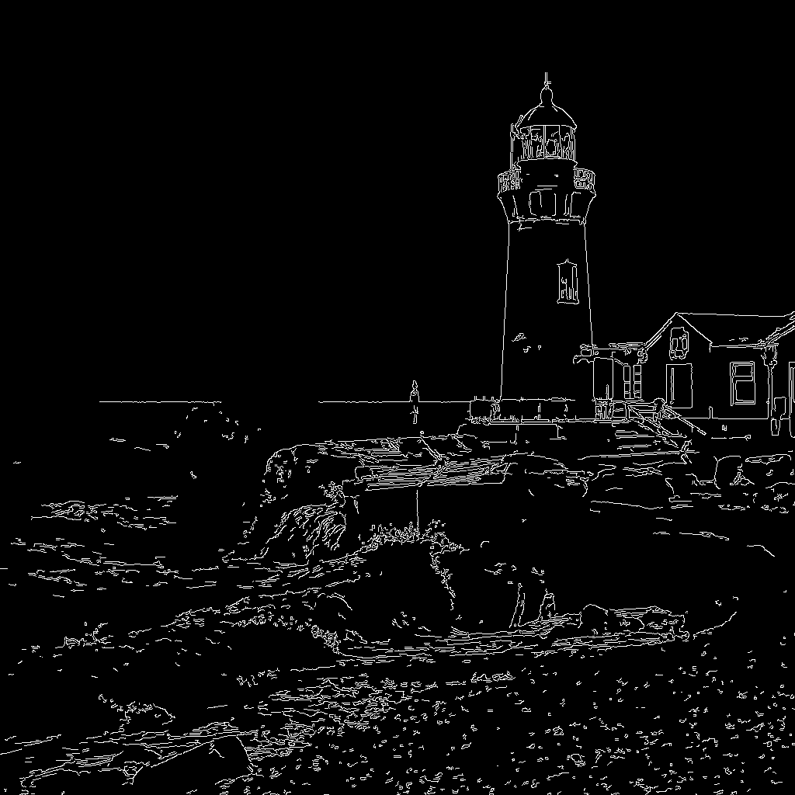

# comfyui-zimageturbo-mlx

Run **[Z-Image-Turbo](https://huggingface.co/Tongyi-MAI/Z-Image-Turbo)** on Apple Silicon through
**MLX**, inside ComfyUI.

ComfyUI's built-in Z-Image nodes run on PyTorch/MPS. On a Mac the same weights run several times
faster through [mflux](https://github.com/filipstrand/mflux)'s MLX implementation — these nodes are
a thin ComfyUI wrapper around mflux's `z-image-turbo` CLI, plus a converter for the community
finetunes that only exist as ComfyUI single-file checkpoints.

```
ComfyUI (Python) ──subprocess──▶ mflux z-image-turbo CLI (MLX) ──▶ PNG ──▶ IMAGE
```

---

## Highlights

- **Two nodes, no graph surgery.** `ZImage MLX Loader` → `ZImage MLX Text to Image` → `SaveImage`.
- **Model dropdown** scanning your MLX snapshots and ComfyUI single-file checkpoints automatically.
- **Finetune friendly.** Point it at a `models/unet/*.safetensors` Z-Image DiT and it converts
  (ComfyUI keys → diffusers keys, fused QKV split) and quantizes it on first use.
- **Works on a 24 GB Mac.** 1024² / 8 steps in ~60 s at 4.3 GB peak with a disk-quantized model.
- **Live progress** in the ComfyUI console and progress bar.

## Requirements

| | |
|---|---|
| OS / chip | macOS on Apple Silicon (arm64) |
| ComfyUI | any recent version |
| Python | 3.10+ with [mflux](https://github.com/filipstrand/mflux) installed (`pip install mflux`) |
| RAM | 16 GB minimum with 4-bit weights, 24 GB+ comfortable |

## Install

```bash
cd ~/ComfyUI/custom_nodes
git clone https://github.com/<you>/comfyui-zimageturbo-mlx.git
```

Restart ComfyUI. The nodes appear under the **ZImage MLX** category.

### Point it at mflux

The nodes do not import mflux (its pinned `mlx`/`transformers` would fight ComfyUI's). They run it in
a subprocess, so they need an interpreter that can import `mflux.models.z_image`:

- if a sibling `custom_nodes/comfyui-qwen21-mlx/.venv` exists, it is used automatically;
- otherwise set it explicitly:

```bash
export ZIMAGE_MLX_PYTHON=/path/to/python-with-mflux
```

Check from a shell:

```bash
python3 -c "import mflux.models.z_image.cli.z_image_turbo_generate" && echo ok
```

## Getting weights

Three ways — pick one:

**A. Let mflux download the base model** (simplest; ~33 GB of fp32 originals)

Select `Tongyi-MAI/Z-Image-Turbo` in the dropdown and run once.

**B. Pre-download the snapshot** (~33 GB, visible on disk, reusable by the converter)

```bash
export HF_ENDPOINT=https://hf-mirror.com HF_HUB_DISABLE_XET=1   # if hf.co is slow/blocked
python -m huggingface_hub.commands.huggingface_cli download Tongyi-MAI/Z-Image-Turbo \
    --local-dir ~/ComfyUI-Shared/models/MLX/Z-Image-Turbo \
    --include "transformer/*" "text_encoder/*" "vae/*" "tokenizer/*" "scheduler/*" "model_index.json"
```

**C. Use a ComfyUI single-file finetune** (what most community models are)

Put the `.safetensors` in `ComfyUI-Shared/models/unet/`, select it in the dropdown, and leave
`auto_prepare` on. First run converts and quantizes it (~15 min, one-off):

```
unet/foo.safetensors ──▶ models/MLX/foo/      (bf16, ~12 GB)
                     └─▶ models/MLX/foo-q4/   (4-bit, ~5.5 GB, used at run time)
```

A `.source` marker is written into the `-q4` directory, so selecting the same file again reuses it.

## Nodes

### ZImage MLX Loader

| input | notes |
|---|---|
| `model` | dropdown: MLX dirs under `models/MLX/*`, single files under `models/unet/*`, plus the HF repo id |
| `quantization` | `4` (default) / `8` / `6` / `bf16`. Ignored for already-quantized dirs |
| `auto_prepare` | convert + quantize a single-file checkpoint on first use |
| `low_ram` | slower, less memory |
| `cache_limit_gb` | cap the MLX cache, `0` = mflux default |
| `verbose` | forward all mflux output to the ComfyUI console |

New model files do not appear in the dropdown live — click **Refresh** in ComfyUI (or restart).

### ZImage MLX Text to Image

| input | default | notes |
|---|---|---|
| `prompt` | — | Chinese and English both work well |
| `width` / `height` | 1024 | multiples of 32, 256–1536 |
| `steps` | 9 | distilled model: 8–9 is the design point |
| `seed` | 42 | low seed variance is a model trait |

There is deliberately **no** `guidance` or `negative_prompt`: Z-Image Turbo is guidance-distilled,
so mflux forces guidance to 0 and never encodes a negative prompt.

Console output while running:

```
[zimage-mlx] 开始生成 1024x1024 steps=8 seed=42 quant=4 model=foo-q4
[zimage-mlx] 采样 1/8 (12%)  1.92s/it  已用 3s
...
[zimage-mlx] 采样 8/8 (100%)  1.44s/it  已用 14s
[zimage-mlx] 完成，用时 59.5s -> zimage_42_1024x1024.png
```

## ControlNet

Z-Image-Turbo has an official **Union ControlNet** — one checkpoint that accepts canny, depth,
pose, hed or mlsd hints:

```
alibaba-pai/Z-Image-Turbo-Fun-Controlnet-Union-2.1
└── Z-Image-Turbo-Fun-Controlnet-Union-2.1-8steps.safetensors   6.71 GB
```

Put it anywhere under `~/ComfyUI-Shared/models/MLX/` (it is found recursively) and pick it in the
node's `controlnet_model` dropdown.

### ZImage MLX ControlNet

| input | notes |
|---|---|
| `control_image` | **already preprocessed** — a Canny edge map, depth map or OpenPose skeleton, not the photo |
| `control_type` | `canny` / `depth` / `pose` / `hed` / `mlsd` — tells the model what the hint is |
| `control_strength` | per-control weight, model card recommends 0.65–1.0 |
| `controlnet_strength` | global multiplier over all controls |
| `prompt`, `width`, `height`, `steps`, `seed` | as in the text-to-image node |

It reuses the same `ZImage MLX Loader`, so a finetune works as the base too. Internally the node
builds a composite directory (`<base>-cn/`) that links the base weights and drops the Union
checkpoint in `controlnet/`, then calls mflux's own `ZImageTurboControlnet` with a ModelConfig that
carries `controlnet_model` — the stock CLI refuses a local path there.

Preprocessing is not bundled: use ComfyUI's `comfyui_controlnet_aux` nodes (Canny, MiDaS/Depth
Anything, OpenPose) or any external tool, then feed the result into `control_image`.

Measured with this node (Canny hint, base = a 4-bit finetune):

| hint | output |
|---|---|
|  |  |

Structure follows the hint (tower position, building on the right, rock shelf); colours and detail
come from the prompt. 4 steps is enough to see the layout but leaves colour artifacts — 8 is the
sane default.

## Performance (measured, M5 / 24 GB)

| setup | time | peak MLX memory |
|---|---|---|
| 512² / 4 steps, bf16 weights | 709 s | 12.95 GB (heavy swap) |
| 512² / 4 steps, 4-bit on disk | 12 s | ~4.4 GB |
| 768² / 8 steps, 4-bit | 34 s | 4.41 GB |
| 1024² / 8 steps, 4-bit | 60 s | 4.34 GB |
| ControlNet canny, 512² / 4 steps | 22 s | — |
| ControlNet canny, 768² / 8 steps | 72 s | — |

The first row is the important one: on 24 GB, loading 12.3 GB of bf16 DiT plus an 8 GB text encoder
thrashes. **Quantize to disk once** and everything is fine:

```bash
mflux-save --model ~/ComfyUI-Shared/models/MLX/foo \
           --path  ~/ComfyUI-Shared/models/MLX/foo-q4 \
           --quantize 4
```

<details>
<summary>More samples</summary>


</details>

## Converting a single-file checkpoint manually

The node does this for you, but the script is usable standalone:

```bash
python3 scripts/convert_zimage_checkpoint.py --input model.safetensors --check   # mapping only, seconds
python3 scripts/convert_zimage_checkpoint.py --input model.safetensors \
    --out ~/ComfyUI-Shared/models/MLX/foo --base ~/ComfyUI-Shared/models/MLX/Z-Image-Turbo
```

`--check` prints a table of tensor counts and fails loudly if upstream renames anything:

```
源张量(展开 qkv)   : 521
模型参数            : 521
无对应映射规则      : 0
形状不一致          : 0
模型里没被填上的参数: 0
RESULT: OK
```

Only the DiT comes from your file — the text encoder (Qwen3-4B), FLUX AE and tokenizer are borrowed
from `--base`, which must be a complete snapshot.

## Troubleshooting

| symptom | fix |
|---|---|
| `找不到能运行 mflux Z-Image 的 Python 环境` | set `ZIMAGE_MLX_PYTHON` to an interpreter with mflux |
| `Value not in list` for `model` | the file was added after ComfyUI started — **Refresh** |
| `选中的单文件不存在` | the checkpoint moved; re-pick it in the dropdown |
| generation takes ~10 min | you are running bf16 weights on a small machine — quantize to disk |
| out of memory | lower resolution, enable `low_ram`, set `cache_limit_gb` |
| download stalls | `HF_ENDPOINT=https://hf-mirror.com HF_HUB_DISABLE_XET=1` |

## License

MIT — see [LICENSE](LICENSE). Model weights are Apache-2.0 (Tongyi-MAI).

## Credits

- [Tongyi-MAI/Z-Image](https://github.com/Tongyi-MAI/Z-Image) — the model
- [mflux](https://github.com/filipstrand/mflux) — MLX inference runtime, which does the actual work
- ComfyUI — the graph
