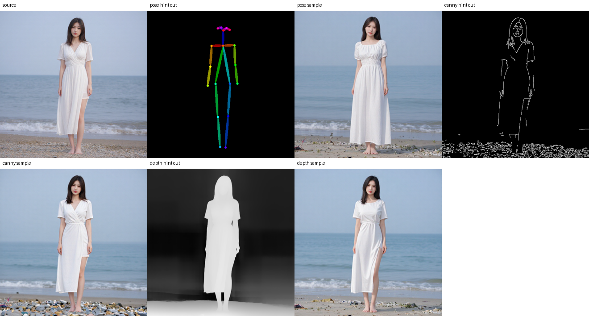
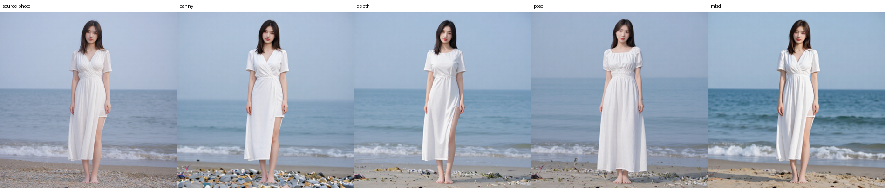

# comfyui-zimageturbo-mlx

Run **[Z-Image-Turbo](https://huggingface.co/Tongyi-MAI/Z-Image-Turbo)** on Apple Silicon through
**MLX**, inside ComfyUI.

ComfyUI's built-in Z-Image nodes run on PyTorch/MPS. On a Mac the same weights run several times
faster through [mflux](https://github.com/filipstrand/mflux)'s MLX implementation — these nodes are
a thin ComfyUI wrapper around mflux's `z-image-turbo` CLI, plus a converter for the community
finetunes that only exist as ComfyUI single-file checkpoints.

```
ComfyUI (Python) ──subprocess──▶ mflux z-image-turbo CLI (MLX) ──▶ PNG ──▶ IMAGE
```

---

## Highlights

- **Two nodes, no graph surgery.** `ZImage MLX Loader` → `ZImage MLX Text to Image` → `SaveImage`.
- **Model dropdown** scanning your MLX snapshots and ComfyUI single-file checkpoints automatically.
- **Finetune friendly.** Point it at a `models/unet/*.safetensors` Z-Image DiT and it converts
  (ComfyUI keys → diffusers keys, fused QKV split) and quantizes it on first use.
- **Works on a 24 GB Mac.** 1024² / 8 steps in ~60 s at 4.3 GB peak with a disk-quantized model.
- **Live progress** in the ComfyUI console and progress bar.

## Requirements

| | |
|---|---|
| OS / chip | macOS on Apple Silicon (arm64) |
| ComfyUI | any recent version |
| Python | 3.10+ with [mflux](https://github.com/filipstrand/mflux) installed (`pip install mflux`) |
| RAM | 16 GB minimum with 4-bit weights, 24 GB+ comfortable |

## Install

```bash
cd ~/ComfyUI/custom_nodes
git clone https://github.com/<you>/comfyui-zimageturbo-mlx.git
```

Restart ComfyUI. The nodes appear under the **ZImage MLX** category.

### Point it at mflux

The nodes do not import mflux (its pinned `mlx`/`transformers` would fight ComfyUI's). They run it in
a subprocess, so they need an interpreter that can import `mflux.models.z_image`:

- if a sibling `custom_nodes/comfyui-qwen21-mlx/.venv` exists, it is used automatically;
- otherwise set it explicitly:

```bash
export ZIMAGE_MLX_PYTHON=/path/to/python-with-mflux
```

Check from a shell:

```bash
python3 -c "import mflux.models.z_image.cli.z_image_turbo_generate" && echo ok
```

## Getting weights

Three ways — pick one:

**A. Let mflux download the base model** (simplest; ~33 GB of fp32 originals)

Select `Tongyi-MAI/Z-Image-Turbo` in the dropdown and run once.

**B. Pre-download the snapshot** (~33 GB, visible on disk, reusable by the converter)

```bash
export HF_ENDPOINT=https://hf-mirror.com HF_HUB_DISABLE_XET=1   # if hf.co is slow/blocked
python -m huggingface_hub.commands.huggingface_cli download Tongyi-MAI/Z-Image-Turbo \
    --local-dir ~/ComfyUI-Shared/models/MLX/Z-Image-Turbo \
    --include "transformer/*" "text_encoder/*" "vae/*" "tokenizer/*" "scheduler/*" "model_index.json"
```

**B2. Fetch the shared base assets (~8.2 GB, or ~20 GB with the DiT)**

A single-file finetune is only the DiT; converting it needs the Qwen3-4B encoder, the FLUX AE and the
tokenizer as a `--base`. If you do not have a snapshot yet:

```bash
python3 scripts/fetch_base_assets.py                    # shared components only (~8.2 GB, --base use)
python3 scripts/fetch_base_assets.py --with-transformer  # + the 12.3 GB bf16 DiT -> runnable model
```

The DiT comes from `mlx-community/Z-Image-Turbo-bf16` (half the bytes of the fp32 original); the rest
from `Tongyi-MAI/Z-Image-Turbo`, through hf-mirror with ranged resume (huggingface_hub stalls / 401s
on Xet for this repo).

> A directory holding only the shared components is **not** a runnable model — `transformer/` needs
> `*.safetensors` or mflux fails with `No safetensors files found`. The Loader now rejects such a
> snapshot up front and prints the command above.

On a 24 GB machine, quantize the bf16 snapshot once so loads don't thrash:

```bash
mflux-save --model ~/ComfyUI-Shared/models/MLX/Z-Image-Turbo \
           --path  ~/ComfyUI-Shared/models/MLX/Z-Image-Turbo-q4 --quantize 4
```

**B1. Fetch only the shared base assets (~8.2 GB)**

A single-file finetune is only the DiT; converting it needs the Qwen3-4B encoder, the FLUX AE and the
tokenizer as a `--base`. If you do not have a snapshot yet:

```bash
python3 scripts/fetch_base_assets.py          # -> ~/ComfyUI-Shared/models/MLX/Z-Image-Turbo
```

It pulls `text_encoder/ vae/ tokenizer/ scheduler/` from `Tongyi-MAI/Z-Image-Turbo` through
hf-mirror with ranged resume (huggingface_hub stalls / 401s on Xet for this repo).

**C. Use a ComfyUI single-file finetune** (what most community models are)

Put the `.safetensors` in `ComfyUI-Shared/models/unet/`, select it in the dropdown, and leave
`auto_prepare` on. First run converts and quantizes it (~15 min, one-off):

```
unet/foo.safetensors ──▶ models/MLX/foo/      (bf16, ~12 GB)
                     └─▶ models/MLX/foo-q4/   (4-bit, ~5.5 GB, used at run time)
```

A `.source` marker is written into the `-q4` directory, so selecting the same file again reuses it.

## Nodes

### ZImage MLX Loader

| input | notes |
|---|---|
| `model` | dropdown: MLX dirs under `models/MLX/*`, single files under `models/unet/*`, plus the HF repo id |
| `quantization` | `4` (default) / `8` / `6` / `bf16`. Ignored for already-quantized dirs |
| `auto_prepare` | convert + quantize a single-file checkpoint on first use |
| `low_ram` | slower, less memory |
| `cache_limit_gb` | cap the MLX cache, `0` = mflux default |
| `verbose` | forward all mflux output to the ComfyUI console |

New model files do not appear in the dropdown live — click **Refresh** in ComfyUI (or restart).

### ZImage MLX Text to Image

| input | default | notes |
|---|---|---|
| `prompt` | — | Chinese and English both work well |
| `width` / `height` | 1024 | multiples of 32, 256–1536 |
| `steps` | 9 | distilled model: 8–9 is the design point |
| `seed` | 42 | low seed variance is a model trait |

There is deliberately **no** `guidance` or `negative_prompt`: Z-Image Turbo is guidance-distilled,
so mflux forces guidance to 0 and never encodes a negative prompt.

Console output while running:

```
[zimage-mlx] 开始生成 1024x1024 steps=8 seed=42 quant=4 model=foo-q4
[zimage-mlx] 采样 [███░░░░░░░░░░░░░░░░░░░░░] 1/8  12%  1.92s/it  已用 3s
[zimage-mlx] 采样 [██████░░░░░░░░░░░░░░░░░░] 2/8  25%  1.71s/it  已用 6s
...
[zimage-mlx] 采样 [████████████████████████] 8/8 100%  1.44s/it  已用 14s
[zimage-mlx] 完成，用时 59.5s -> zimage_42_1024x1024.png
```

On a real terminal the bar rewrites the same line (`\r`) instead of scrolling; when stdout is a log
file (ComfyUI Desktop) it appends one line per step so nothing is lost.

## ControlNet

Z-Image-Turbo has an official **Union ControlNet** — one checkpoint that accepts five hint types:

```
alibaba-pai/Z-Image-Turbo-Fun-Controlnet-Union-2.1
└── Z-Image-Turbo-Fun-Controlnet-Union-2.1-8steps.safetensors   6.71 GB
```

Drop it anywhere under `~/ComfyUI-Shared/models/MLX/` (scanned recursively) and pick it in the
`controlnet_model` dropdown.

The graph is split the way ComfyUI users expect — a ControlNet node and a Sampler node:

```
ZImage MLX Loader ─────────────────────────────┐
LoadImage (source photo) ─▶ ZImage MLX ControlNet ─▶ ZImage MLX Sampler ─▶ SaveImage
```

### ZImage MLX ControlNet

| input | notes |
|---|---|
| `control_image` | **the original photo** — see below |
| `control_type` | `canny` / `depth` / `pose` / `hed` / `mlsd` |
| `control_strength` | per-control weight, model card recommends 0.65–1.0 |
| `controlnet_strength` | global multiplier |
| `controlnet_model` | dropdown over the Union checkpoints found on disk |

**Outputs**

| output | contents |
|---|---|
| `control` | the bundle the Sampler consumes (`ZIMAGE_MLX_CN`) |
| `control_image_preview` | the **preprocessed** hint as an `IMAGE` — wire it to `PreviewImage` to see the canny/depth/pose/hed/mlsd map the model actually received |

The hint is rendered once, in the node, by the same mflux function the sampler used to run
invisibly (`ZImageControlnetUtil._preprocess`). The Sampler then passes `--preprocessed`, so the
signal is not processed twice:



⚠️ **Feed the raw photo, not a preprocessed hint.** In mflux `control_type` is not a label: before
encoding it runs the matching preprocessor itself (`canny`→OpenCV Canny, `depth`→DepthPro,
`pose`→OpenPose, `hed`→HED, `mlsd`→OpenCV LSD). Handing it a skeleton it will happily try to detect
a person *inside the skeleton* and produce mush. Because of that you also do **not** need
`comfyui_controlnet_aux` in the graph.

### ZImage MLX Sampler

Takes the optional `control` output. Without it the node is a plain text-to-image sampler, so one
sampler serves both workflows.

| input | default | notes |
|---|---|---|
| `prompt` | — | |
| `width` / `height` | 1024 | multiple of 32, 256–1536; **ignored when `image` is connected** |
| `steps` | 8 | 8–9 is the distilled design point |
| `seed` | 42 | |
| `image` (optional) | — | connect → **image-to-image**; unconnected → text-to-image |
| `image_strength` | 0.6 | only used with `image`: how far to repaint (mflux default 0.4) |
| `control` (optional) | — | output of `ZImage MLX ControlNet` |

### EasyCache (step reuse)

`Z-Image-Turbo MLX EasyCache` sits between the Loader and the Sampler and turns on mflux's
TeaCache-style `StepCache`: the steps whose sigma changes least are skipped and the previous step's
prediction is reused. It is config-in / config-out, so it can be dropped in or bypassed for A/B.

```
ZImage MLX Loader ─▶ ZImage MLX EasyCache ─▶ ZImage MLX Sampler
```

| input | default | notes |
|---|---|---|
| `enabled` | true | off = straight passthrough |
| `reuse_ratio` | 0.15 | share of steps to skip; 8 steps → 0.15 skips 1, 0.3 skips 2 |

Measured at 512² / 8 steps on a 4-bit snapshot:

| ratio | skipped | time | mean pixel difference vs no cache |
|---|---|---|---|
| 0 | — | 30.2 s | — |
| 0.15 | 1/8 | 24.6 s | 7.2 |
| 0.30 | 2/8 | 21.1 s | 11.6 |

mflux disables its cache below 10 steps; the driver lowers that floor to 2 because Z-Image-Turbo
lives at 8–9 steps, and it never skips the first step. The sampler prints how many steps were skipped
when the run finishes.

The ControlNet path does **not** use the cache (mflux's ControlNet pipeline has no cache hook), so the
node is a passthrough there and the sampler says so in the console.

### Image-to-image

Connect an `IMAGE` and the sampler switches to encode → denoise → decode. The output size follows the
**input image** (snapped to a multiple of 32); the `width`/`height` widgets are ignored, so a 768×512
photo comes back 768×512.

`image_strength` maps to mflux's `--image` strength, which is **how much of the input is kept**, not
how hard it is repainted — the direction is the opposite of ComfyUI's `denoise`:

```
init_time_step = max(1, int(steps * strength))      # mflux
latents = (1 - sigma) * encoded_image + sigma * noise
```

A larger strength starts denoising later in the schedule, so less noise is mixed in and the output
stays closer to the input. Measured on a 768×512 photo (8 steps):

| strength | mean pixel distance from input | effect |
|---|---|---|
| 0.3 | 26.4 | heavy repaint — composition survives, subject is redrawn |
| 0.6 | 12.9 | clear edit, subject kept (node default) |
| 0.9 | 5.0 | light touch-up, nearly the same picture |
| 1.0 | ≈ 0 | basically returns the input |

Because the first `max(1, int(steps * strength))` steps are skipped, a high strength also runs
*fewer* denoise steps (0.9 with 8 steps = 1 step of work), which is why it is fast and barely
changes anything. The node prints the effective count in the console.

`0.05` (the minimum) is close to pure text-to-image; there is no "0 = ignore image", because mflux
only enters the image-to-image path when strength > 0.

`control` and `image` are mutually exclusive: mflux's ControlNet CLI has no `--image`, so the node
raises a clear error rather than silently ignoring one of them.

### Verified hint types

Same source photo, four control types, 512² / 8 steps, 4-bit finetune as base:



All four follow the subject's pose and framing while changing material/background per the prompt.
`hed` uses the same native-MLX HED port (weights from `lllyasviel/Annotators`) but was not exercised
in this test run.

Timing: 512²/4 steps ≈ 25 s, 512²/8 ≈ 42 s, 768²/8 ≈ 72 s (control runs are slower than plain
text-to-image because the hint is VAE-encoded every call).

## Workflows shipped

| file | graph |
|---|---|
| `workflows/zimage_turbo_mlx.json` | Loader → Sampler → Save (text-to-image) |
| `workflows/zimage_turbo_i2i_mlx.json` | Loader + LoadImage → Sampler → Save (image-to-image) |
| `workflows/zimage_turbo_controlnet_mlx.json` | Loader + LoadImage → ControlNet → Sampler → Save + hint preview |

## Performance (measured, M5 / 24 GB)

| setup | time | peak MLX memory |
|---|---|---|
| 512² / 4 steps, bf16 weights | 709 s | 12.95 GB (heavy swap) |
| 512² / 4 steps, 4-bit on disk | 12 s | ~4.4 GB |
| 768² / 8 steps, 4-bit | 34 s | 4.41 GB |
| 1024² / 8 steps, 4-bit | 60 s | 4.34 GB |
| ControlNet canny, 512² / 4 steps | 22 s | — |
| ControlNet canny, 768² / 8 steps | 72 s | — |

The first row is the important one: on 24 GB, loading 12.3 GB of bf16 DiT plus an 8 GB text encoder
thrashes. **Quantize to disk once** and everything is fine:

```bash
mflux-save --model ~/ComfyUI-Shared/models/MLX/foo \
           --path  ~/ComfyUI-Shared/models/MLX/foo-q4 \
           --quantize 4
```

<details>
<summary>More samples</summary>


</details>

## Converting a single-file checkpoint manually

The node does this for you, but the script is usable standalone:

```bash
python3 scripts/convert_zimage_checkpoint.py --input model.safetensors --check   # mapping only, seconds
python3 scripts/convert_zimage_checkpoint.py --input model.safetensors \
    --out ~/ComfyUI-Shared/models/MLX/foo --base ~/ComfyUI-Shared/models/MLX/Z-Image-Turbo
```

`--check` prints a table of tensor counts and fails loudly if upstream renames anything:

```
源张量(展开 qkv)   : 521
模型参数            : 521
无对应映射规则      : 0
形状不一致          : 0
模型里没被填上的参数: 0
RESULT: OK
```

Only the DiT comes from your file — the text encoder (Qwen3-4B), FLUX AE and tokenizer are borrowed
from `--base`, which must be a complete snapshot.

## Troubleshooting

| symptom | fix |
|---|---|
| `找不到能运行 mflux Z-Image 的 Python 环境` | set `ZIMAGE_MLX_PYTHON` to an interpreter with mflux |
| `Value not in list` for `model` | the file was added after ComfyUI started — **Refresh** |
| `选中的单文件不存在` | the checkpoint moved; re-pick it in the dropdown |
| generation takes ~10 min | you are running bf16 weights on a small machine — quantize to disk |
| out of memory | lower resolution, enable `low_ram`, set `cache_limit_gb` |
| download stalls | `HF_ENDPOINT=https://hf-mirror.com HF_HUB_DISABLE_XET=1` |

## License

MIT — see [LICENSE](LICENSE). Model weights are Apache-2.0 (Tongyi-MAI).

## Credits

- [Tongyi-MAI/Z-Image](https://github.com/Tongyi-MAI/Z-Image) — the model
- [mflux](https://github.com/filipstrand/mflux) — MLX inference runtime, which does the actual work
- ComfyUI — the graph
